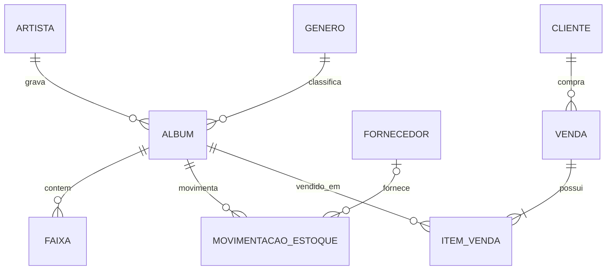

# Loja de Álbuns

Projeto Final de Desenvolvimento Web com Yesod (Haskell).

## 1. Descrição

Sistema web para uma loja de discos (CDs e vinis) controlar o catálogo, o
estoque e as vendas. Os álbuns podem ser cadastrados à mão ou importados do
**MusicBrainz**, que preenche título, artista, ano, faixas e capa.

Funcionalidades:

- **Painel** na página inicial: vendas e faturamento do mês, ticket médio,
  unidades e valor do estoque, álbuns mais vendidos, álbuns com estoque baixo
  e últimas vendas.
- **Catálogo**: CRUD de artistas, gêneros, álbuns e faixas. Um mesmo título
  pode existir em formatos diferentes (CD, Vinil ou Cassete), cada um
  com preço e estoque próprios.
- **Busca e filtros** na lista de álbuns: texto (título ou artista), gênero,
  formato, situação do estoque e ordenação.
- **Importação do MusicBrainz**: busca de lançamentos, pré-visualização com
  faixas e capa, e gravação do álbum com todas as faixas.
- **Fornecedores** (com validação de CNPJ) e **entrada de mercadoria**, que
  soma ao estoque e registra o custo unitário.
- **Estoque**: situação de cada álbum e histórico de movimentações.
- **Clientes** (com validação de CPF) e **vendas** com vários itens. A venda
  confere se há estoque, dá baixa automaticamente e pode ser cancelada
  (o estoque volta).

## 2. Tecnologias

| Tecnologia | Uso no projeto |
|---|---|
| Haskell (GHC 9.10.3) | Linguagem |
| Stack (snapshot `lts-24.40`) | Build e dependências |
| Yesod 1.6 (`yesod-core`, `yesod-form`, `yesod-static`) | Framework web: rotas, handlers, formulários e arquivos estáticos |
| Persistent + SQLite (`persistent-sqlite`) | Modelo de dados, migração automática e consultas |
| Shakespeare (Hamlet e Lucius) | Templates HTML e CSS |
| `http-conduit` + `aeson` | Requisições HTTP e leitura do JSON das APIs |
| `time`, `containers`, `text` | Datas, mapas e texto |

## 3. Como executar

Pré-requisito: [Stack](https://docs.haskellstack.org/en/stable/install_and_upgrade/)
instalado.

```bash
git clone https://github.com/souzagabrieln/projeto-web-yesod.git
cd projeto-web-yesod
stack build      # a primeira vez demora: baixa o GHC e as bibliotecas
stack run
```

Depois abra **http://localhost:8080** no navegador.

- O banco é um arquivo SQLite (`proj.sqlite3`) criado na pasta onde o
  `stack run` foi executado. As tabelas são criadas automaticamente na
  primeira execução (migração do Persistent). Não é preciso instalar banco.
- Para usar outro arquivo, defina a variável `DB_PATH`:
  - Linux/macOS: `DB_PATH=outro.sqlite3 stack run`
  - Windows PowerShell: `$env:DB_PATH = "outro.sqlite3"; stack run`
- A importação do MusicBrainz precisa de internet. O resto funciona offline.

Roteiro rápido para testar: cadastre um gênero → importe um álbum em
*Álbuns → Importar do MusicBrainz* → cadastre um fornecedor → registre uma
entrada em *Estoque* → cadastre um cliente → registre uma venda em *Vendas* →
veja o resultado no *Painel*.

## 4. Estrutura do banco de dados

São 9 tabelas, definidas em `src/Foundation.hs`:

| Tabela | Campos principais | Relacionamentos |
|---|---|---|
| `artista` | nome (único), país, ano de início | tem muitos álbuns |
| `genero` | nome (único), descrição | tem muitos álbuns |
| `album` | título, ano, formato, preço, estoque, URL da capa | pertence a um artista e a um gênero; único por (título, artista, formato) |
| `faixa` | número, título, duração (segundos) | pertence a um álbum; número único dentro do álbum |
| `fornecedor` | nome, CNPJ (único), e-mail, telefone | fornece as entradas de estoque |
| `movimentacao_estoque` | tipo (Entrada/Saída), quantidade, custo unitário, data, observação | pertence a um álbum; entrada aponta o fornecedor |
| `cliente` | nome, CPF (único), e-mail, telefone | tem muitas vendas |
| `venda` | data, total, cancelada | pertence a um cliente; tem muitos itens |
| `item_venda` | quantidade, preço unitário | liga uma venda a um álbum |



Regras importantes:

- O campo `album.estoque` guarda o saldo atual; `movimentacao_estoque` guarda
  o histórico de onde ele veio (entradas de fornecedor e saídas por venda).
- `item_venda.preco_unitario` é copiado do álbum no momento da venda, para que
  mudar o preço depois não altere vendas antigas.
- Venda não é apagada: é cancelada, e as unidades voltam ao estoque.
- Registros em uso não podem ser excluídos (ex.: artista com álbuns, cliente
  com vendas); a aplicação mostra uma mensagem explicando o motivo.

## 5. Integração com API externa

O módulo `src/Api/MusicBrainz.hs` consome duas APIs públicas e gratuitas
(sem chave), usando `http-conduit` para a requisição e `aeson` para ler o JSON.

**MusicBrainz** (`https://musicbrainz.org/ws/2`):

| Endpoint | Para quê |
|---|---|
| `GET /release/?query=...&fmt=json&limit=15` | Busca lançamentos por título (e artista) |
| `GET /release/{mbid}?inc=recordings+artist-credits+genres&fmt=json` | Dados do álbum: título, data, artista, formato da mídia, gêneros e faixas com duração |
| `GET /artist/{mbid}?fmt=json` | País e ano de início do artista |

**Cover Art Archive** (`https://coverartarchive.org`):

| Endpoint | Para quê |
|---|---|
| `GET /release/{mbid}` | Lista de imagens; usamos a miniatura de 250 px da capa frontal |
| `/release/{mbid}/front-250` | Miniatura exibida na lista de resultados da busca |

Como os dados são usados: ao importar, a aplicação cria o artista (ou
reaproveita um já cadastrado com o mesmo nome) com país e ano de início, grava
o álbum com a URL da capa e todas as faixas. O formato (CD, Vinil...) e o
gênero são sugeridos a partir do MusicBrainz, e o usuário confirma o preço.

Cuidados exigidos pela API:

- Toda requisição envia um `User-Agent` que identifica a aplicação.
- O MusicBrainz aceita 1 requisição por segundo. A aplicação espera 1,1 s
  entre as chamadas seguidas e, se receber `503`, tenta de novo até 3 vezes
  (esperando 1,5 s e depois 3 s).
- Falhas de rede, resposta inválida ou álbum não encontrado viram mensagens
  amigáveis na tela, sem derrubar a aplicação.

## 6. Integrantes

| Nome | GitHub | Commits |
|---|---|---|
| Gabriel Nascimento Souza| [@souzagabrieln](https://github.com/souzagabrieln) | layout e CRUD de artistas/gêneros; integração com o MusicBrainz; clientes e vendas |
| Bruna de Araújo Andrade | [littlebodybigheart7] (https://github.com/littlebodybigheart7) | álbuns e faixas; fornecedores e entrada de estoque; painel, filtros e README |

## Estrutura do código

```
app/Main.hs              conexão com o SQLite, migração e servidor na porta 8080
routes.yesodroutes       todas as rotas
src/Foundation.hs        modelo do banco, layout, menu e página 404
src/Application.hs       liga as rotas aos handlers
src/Handler/             uma página (ou grupo de páginas) por arquivo
src/Api/MusicBrainz.hs   cliente do MusicBrainz e do Cover Art Archive
src/Model/               tipos gravados no banco (Formato, TipoMovimentacao)
src/Util/                validações (CPF, CNPJ), formatação de preço e data
templates/               layout.hamlet e layout.lucius
static/img/              logo
```
